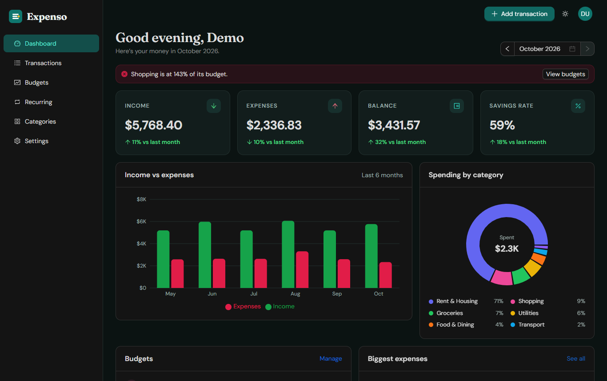
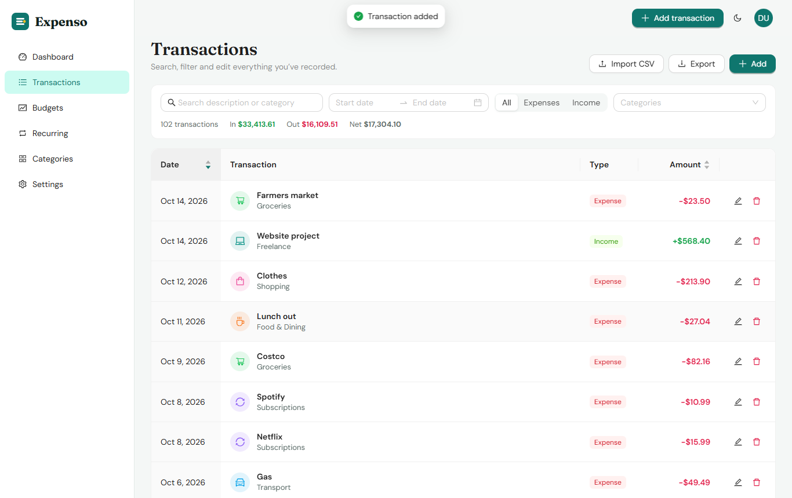
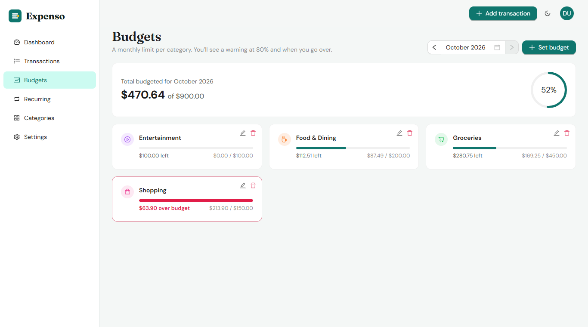
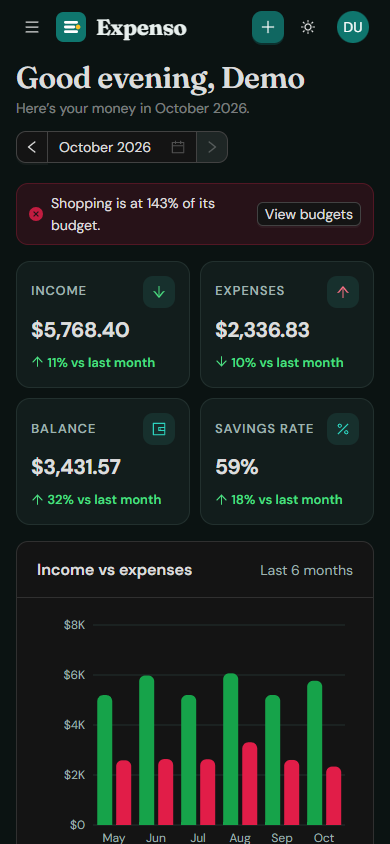
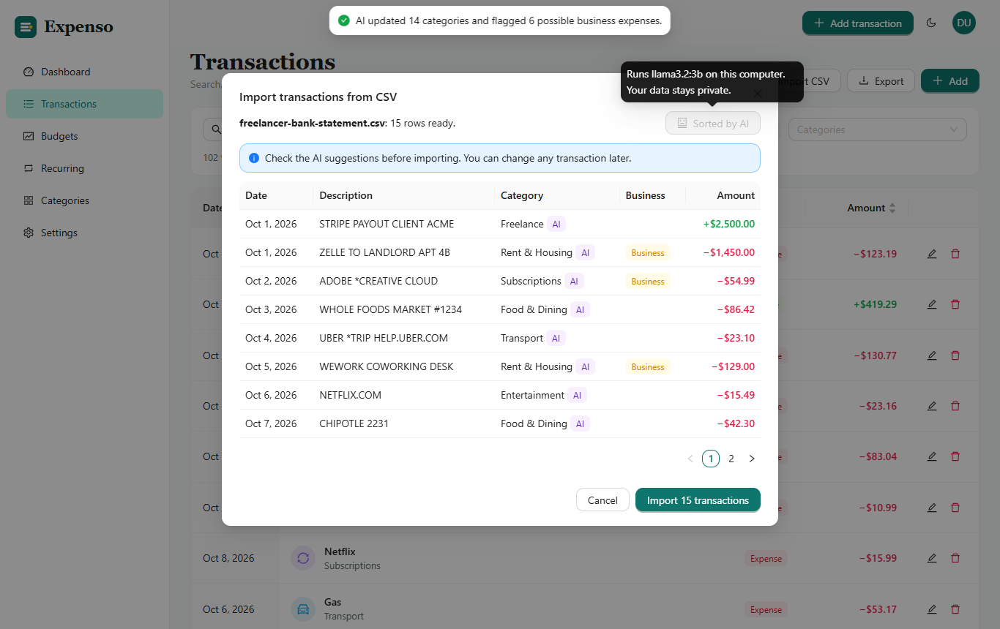
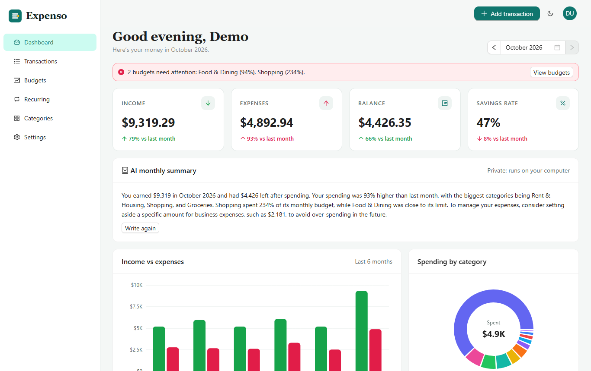

# Expenso

[](https://github.com/kc-2705/expense-management-app/actions/workflows/ci.yml)


A personal finance tracker: record income and expenses, set monthly budgets per category, automate recurring payments, import bank statements, and see where your money goes.

Built with **MongoDB, Express, React and Node.js** (MERN), Ant Design and React Query.



## Features

- **Dashboard:** income, expenses, balance and savings rate for any month, compared with the month before; a 6-month income vs expenses chart; spending by category; biggest expenses; budget alerts.
- **Transactions:** add, edit and delete; search; filter by date range (with presets), type and category; sort by date or amount; server-side paging; running totals for the current filter.
- **Budgets:** a monthly limit per expense category with progress bars that turn amber at 80% and red when you go over.
- **Recurring payments:** rent, salary and subscriptions (weekly, monthly, yearly) are added automatically on their date. Monthly rules keep their day (the 31st lands on Feb 28, then Mar 31).
- **Import and export:** import a bank CSV (signed Amount, or Debit/Credit columns) with a preview before saving; export the current filter as CSV or a PDF report.
- **Categories:** 17 defaults on sign-up; add your own with a color and icon. Renaming one updates its transactions, budgets and recurring payments.
- **Account:** sign up, log in, forgot password with a one-time emailed code, change password, currency, dark mode, delete account.
- **Responsive:** works on phones, with a slide-out menu.
- **Local AI assistant (optional):** auto-categorizes imported bank transactions, flags likely business expenses and writes a monthly summary using an open-source model running on your own computer. See below.

| Transactions | Budgets | Mobile |
| --- | --- | --- |
|  |  |  |

## Local AI assistant (optional)

Expenso can use a **local open-source model** through [Ollama](https://ollama.com) to help freelancers with bookkeeping. The model runs on your own computer, so bank data never goes to a cloud AI service, and it costs nothing to run.

- **Auto-categorize imports:** after uploading a bank CSV, click **Auto-categorize with AI**. Each transaction gets a category from your own list, and likely business costs (software, coworking, client travel, courses) are flagged so they're easy to find at tax time. You review every suggestion before importing.
- **Business expense flag:** mark any expense as a possible business cost. A briefcase icon shows it in the list.
- **Monthly summary:** a short plain-English recap on the dashboard. All numbers and comparisons are worked out in code first and the model only phrases them, which keeps a small model from getting the math wrong.

| AI categorization | Monthly summary |
| --- | --- |
|  |  |

**Set up:**

```bash
# 1. Install Ollama from https://ollama.com, then download a small model (about 2 GB):
ollama pull llama3.2:3b
# 2. Start Expenso as usual. The AI buttons turn on automatically when Ollama is running.
```

Try it with `docs/sample/freelancer-bank-statement.csv`. In testing on that file, `llama3.2:3b` picked the right category for 15 of 15 transactions in about 16 seconds on a laptop GPU. Transactions are sent in batches of 5, which proved more accurate than sending them all at once. To use a different model, set `OLLAMA_MODEL` in `.env`.

## Security

- Passwords hashed with **bcrypt**; never stored or returned in plain text.
- **JWT** sessions. The user id comes from the signed token, never from the request, so one user can never read or change another user's data (covered by tests).
- Password reset uses a **6-digit code** that is hashed, expires in 15 minutes, works once and allows 5 tries.
- Input validated with **Zod**; **Helmet** security headers; **rate limiting** on login and reset; CORS limited to the app's own address.
- Secrets live in `.env`, which is git-ignored. See `.env.example`.

## Tech

| Part | Stack |
| --- | --- |
| Front end | React 19, Vite, Ant Design 6, React Query, React Router, Recharts, Day.js, PapaParse, jsPDF |
| Back end | Node.js, Express 5, Mongoose 9, Zod, bcrypt, JSON Web Tokens, Helmet, express-rate-limit, Nodemailer |
| Tests | Node test runner, Supertest, mongodb-memory-server (22 tests: API + AI assistant) |

```
server/
  app.js               Express app: security, CORS, routes, errors
  routes.js            All API routes (public auth, then signed-in only)
  controllers/         auth, transactions, categories, budgets, recurring, summary
  models/              User, Transaction, Category, Budget, Recurring
  middleware/          JWT auth, error handling
  services/            recurring payments, default categories, email
client/src/
  pages/               Landing, auth, Dashboard, Transactions, Budgets, Recurring, Categories, Settings
  components/          Layout, charts, transaction form, CSV import, budget bars
  api/                 Axios client and React Query hooks
tests/api.test.js      API tests
tests/ai.test.js       AI assistant tests (fake Ollama, no model needed)
scripts/demo.js        Demo server with sample data
```

## Run it

Requires Node.js 18 or newer.

```sh
npm install
npm install --prefix client
```

**Quick demo, no database needed.** Starts an in-memory database with 6 months of sample data:

```sh
npm run dev:all
```

Open http://localhost:5173 and log in with `demo@expenso.app` / `demo12345`. Data resets when you stop it.

**With your own database.** Create a free cluster on [MongoDB Atlas](https://www.mongodb.com/atlas), copy `.env.example` to `.env`, fill in `MONGO_URL` and `JWT_SECRET`, then:

```sh
npm run dev        # API on http://localhost:8080
npm run client     # app on http://localhost:5173
```

**Production.** `npm run build` builds the React app, and `npm start` serves the API and the app from one server.

## Tests

```sh
npm test
```

Covers sign-up and login, password hashing, the reset code flow, that users can't see or change each other's data, filters and paging, dashboard totals, budget warnings, recurring payments and category renames.

## API

All routes are under `/api/v1`. Everything except sign-up, login and password reset needs `Authorization: Bearer <token>`.

| Method | Path | What it does |
| --- | --- | --- |
| POST | `/auth/register`, `/auth/login` | Create an account or log in; returns a token |
| POST | `/auth/forgot-password`, `/auth/reset-password` | Email a reset code; reset with the code |
| GET, PUT, DELETE | `/auth/me` | Profile, update name/currency, delete account |
| PUT | `/auth/password` | Change password |
| GET, POST | `/transactions` | List (filters, search, sort, paging) or add |
| PUT, DELETE | `/transactions/:id` | Edit or delete |
| POST | `/transactions/import` | Add many rows from a CSV |
| GET | `/summary?month=YYYY-MM` | Everything the dashboard shows |
| GET, PUT | `/budgets` | Budgets with this month's spending; set one |
| GET, POST, PUT, DELETE | `/categories`, `/recurring` | Manage categories and recurring payments |

---

Built by Kavya Immanni.
